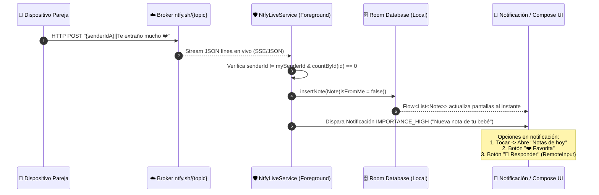
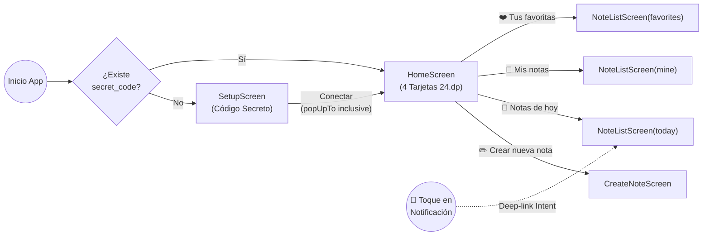

# 📋 Plan de Acción: "Notas para mi bebe" (App Android con Interacción En Vivo)

## 1. Objetivo y Contexto Arquitectónico

Construir desde cero la aplicación Android nativa **"Notas para mi bebe"** (Kotlin + Jetpack Compose + Material 3) respetando íntegramente la Especificación Técnica Maestra y **blindando el sistema de escucha en tiempo real ("en vivo")** para que las notas lleguen al instante sin importar si la aplicación está minimizada o con la pantalla bloqueada, sin depender de servidores propietarios ni cuentas de Firebase.

### ¿Por qué blindar el diseño original de `NotesApplication`?
En Android 8+ (y con mayor severidad en Android 12 a 15), un `CoroutineScope` alojado únicamente en `NotesApplication` muere o entra en *Doze Mode* pocos minutos después de apagar la pantalla, cortando el socket HTTP de OkHttp. Para garantizar una experiencia **100% en vivo**, implementaremos un **`ForegroundService` (`NtfyLiveService`)** de tipo `specialUse` / `dataSync` acompañado de monitoreo de conectividad (`ConnectivityManager`) y reconexión con *exponential backoff*, además de notificaciones ricas con **acciones rápidas** (*Guardar en favoritas*, *Respuesta rápida in-line* y navegación directa a *Notas de hoy*).



---

## 2. Decisiones de Diseño Clave (User Review Required)

> [!IMPORTANT]
> **Dos Canales de Notificación Independientes**
> Para que Android mantenga vivo el stream de `ntfy.sh` 24/7 sin molestar al usuario:
> 1. **`live_connection_channel` (`IMPORTANCE_LOW` / Silencioso):** Muestra la notificación persistente discreta requerida por el `ForegroundService` (*"Conectado en vivo con tu bebé 💞"*). No suena ni vibra.
> 2. **`notes_channel` (`IMPORTANCE_HIGH` / Prioritaria):** Es la notificación real que salta como *Heads-Up* con sonido y vibración cada vez que llega una nota nueva (*"Nueva nota de tu bebé"*).

> [!TIP]
> **Permiso `POST_NOTIFICATIONS` en Android 13+ (API 33+)**
> Al guardar el código secreto en `SetupScreen` (o al iniciar `HomeScreen`), se solicitará el permiso de notificaciones en tiempo de ejecución mediante `rememberLauncherForActivityResult(RequestPermission())` antes de levantar el `NtfyLiveService`, asegurando que el sistema permita mostrar tanto el estado en vivo como las alertas entrantes.

---

## 3. Estructura del Proyecto y Componentes a Construir

El proyecto se creará en `C:\Users\maxim\.gemini\antigravity\scratch\NotasParaMiBebe` con la siguiente arquitectura por capas (`com.notasparamibebe.app`):

```text
app/src/main/java/com/notasparamibebe/app/
├── NotesApplication.kt                 # Inicialización de canales, repositorio y arranque de servicio
├── MainActivity.kt                     # Host Compose, Edge-to-Edge, manejo de Deep-Link de notificación
├── data/
│   ├── local/
│   │   ├── Note.kt                     # Entidad Room (@Entity tableName = "notes")
│   │   ├── NoteDao.kt                  # Consultas Flow, inserción IGNORE, favoritos y borrado
│   │   └── AppDatabase.kt              # Singleton RoomDatabase
│   ├── preferences/
│   │   └── PreferenceRepository.kt     # DataStore (secret_code, sender_id UUID)
│   └── repository/
│       └── NotesRepository.kt          # Orquestador entre Room, DataStore y NtfyClient
├── network/
│   ├── NtfyMessage.kt                  # Modelo JSON (@JsonClass) para eventos de ntfy.sh
│   └── NtfyClient.kt                   # OkHttp POST + Stream continuo callbackFlow (readTimeout = 0)
├── service/
│   ├── NtfyLiveService.kt              # ForegroundService persistente + NetworkCallback + Reconexión
│   ├── BootCompletedReceiver.kt        # Reinicia el servicio automáticamente al encender el teléfono
│   └── NotificationActionReceiver.kt   # BroadcastReceiver para "❤️ Favorita" y "💬 Responder"
└── ui/
    ├── theme/                          # Color.kt (Paleta pastel/azul cielo), Theme.kt, Type.kt
    ├── navigation/
    │   └── AppNavigation.kt            # NavHost (setup, home, create, list/{filterType})
    ├── viewmodel/
    │   └── NotesViewModel.kt           # Estados reactivos UI, envío y filtrado de notas
    └── screens/
        ├── SetupScreen.kt              # Bienvenida y conexión por código secreto
        ├── HomeScreen.kt               # 4 tarjetas principales (24.dp)
        ├── CreateNoteScreen.kt         # Editor expandido y envío con estado
        └── NoteListScreen.kt           # Lista reutilizable (today, mine, favorites, all) + AlertDialog
```

---

### Fase 1: Configuración de Gradle, Permisos y Manifiesto

#### [NEW] `gradle/libs.versions.toml` & `app/build.gradle.kts`
- Configuración de **JVM 11**, plugin de **Compose Compiler** y **KSP** (para Room y Moshi).
- Dependencias oficiales:
  - `androidx.compose.material3:material3` y `material-icons-extended`
  - `androidx.navigation:navigation-compose`
  - `androidx.room:room-runtime`, `room-ktx` y `room-compiler` (KSP)
  - `androidx.datastore:datastore-preferences`
  - `com.squareup.okhttp3:okhttp`
  - `com.squareup.moshi:moshi-kotlin` y `moshi-kotlin-codegen` (KSP)
  - `androidx.lifecycle:lifecycle-viewmodel-compose`, `lifecycle-runtime-compose`, `lifecycle-service`

#### [NEW] `app/src/main/AndroidManifest.xml`
Incluirá los permisos de la especificación más los permisos necesarios para mantener el servicio en vivo en segundo plano y reiniciar tras reinicio del dispositivo:
```xml
<uses-permission android:name="android.permission.INTERNET" />
<uses-permission android:name="android.permission.ACCESS_NETWORK_STATE" />
<uses-permission android:name="android.permission.POST_NOTIFICATIONS" />
<uses-permission android:name="android.permission.FOREGROUND_SERVICE" />
<uses-permission android:name="android.permission.FOREGROUND_SERVICE_SPECIAL_USE" />
<uses-permission android:name="android.permission.RECEIVE_BOOT_COMPLETED" />
```
Además registrará:
- `MainActivity` con `android:launchMode="singleTop"` para que al tocar la notificación no recree múltiples instancias de la app, sino que navegue directamente a `"Notas de hoy"`.
- `NtfyLiveService` con `android:foregroundServiceType="specialUse"`.
- `NotificationActionReceiver` para procesar los botones de la notificación en segundo plano.
- `BootCompletedReceiver` para reconectar automáticamente al encender el móvil si ya hay un `secret_code` guardado.

---

### Fase 2: Capa de Persistencia (Room + DataStore)

#### [NEW] `data/local/Note.kt`
```kotlin
@Entity(tableName = "notes")
data class Note(
    @PrimaryKey val id: String,
    val content: String,
    val timestamp: Long,
    val isFromMe: Boolean,
    val isFavorite: Boolean = false
)
```

#### [NEW] `data/local/NoteDao.kt`
Implementación exacta de las consultas reactivas con `Flow`:
- `getAllNotes(): Flow<List<Note>>` (`ORDER BY timestamp DESC`)
- `getNotesByOrigin(isFromMe: Boolean): Flow<List<Note>>`
- `getFavoriteNotes(): Flow<List<Note>>` (`WHERE isFavorite = 1`)
- `getNotesFromToday(startOfDay: Long): Flow<List<Note>>` (`WHERE isFromMe = 0 AND timestamp >= :startOfDay`)
- `insertNote(note: Note)` (`OnConflictStrategy.IGNORE`)
- `updateFavoriteStatus(id: String, isFavorite: Boolean)`
- `countById(id: String): Int`
- `deleteNoteById(id: String)`

#### [NEW] `data/preferences/PreferenceRepository.kt`
- Gestiona `secret_code` (`Flow<String?>`) y `sender_id` (`String`).
- En la primera lectura de `sender_id`, si no existe en `DataStore`, genera automáticamente `UUID.randomUUID().toString()`, lo persiste de forma atómica y lo retorna.

---

### Fase 3: Motor de Red y Sincronización "En Vivo" (`ntfy.sh`)

#### [NEW] `network/NtfyMessage.kt` & `network/NtfyClient.kt`
- **Sanitización de Topic:** Función `sanitizeTopic(rawCode: String)` que transforma el código secreto a minúsculas y reemplaza cualquier carácter fuera de `[a-z0-9-_]` (o aplica un prefijo único como `notas_bebe_<codigo_sanitizado>`) para evitar colisiones accidentales en el servidor público de `ntfy.sh`.
- **Envío (`sendNote`):**
  1. Crea una instancia local de `Note` con `isFromMe = true` y la guarda en `Room` inmediatamente para respuesta visual instantánea.
  2. Construye el payload `"{senderId}||{contenido_de_la_nota}"` y ejecuta un `POST` a `https://ntfy.sh/{topic}`.
- **Escucha en Tiempo Real (`listenToTopic`):**
  - Usa un cliente `OkHttpClient` dedicado con:
    - `readTimeout(0, TimeUnit.MILLISECONDS)` (para no cerrar nunca el stream por inactividad).
    - `pingInterval(30, TimeUnit.SECONDS)` (keep-alive a nivel HTTP/2 para evitar cierres silenciosos por NAT/routers móviles).
  - Se conecta a `https://ntfy.sh/{topic}/json?since=all`.
  - Lee línea por línea con `BufferedSource.readUtf8Line()` dentro de un `callbackFlow`.
  - Filtra únicamente los eventos con `event == "message"`.

---

### Fase 4: Blindaje en Segundo Plano y Notificaciones Interactivas

#### [NEW] `service/NtfyLiveService.kt`
Servicio en primer plano que garantiza que la conexión siga viva aunque el usuario cierre la vista o bloquee el celular:
1. **Ciclo de Vida y CoroutineScope:** Posee un `CoroutineScope(SupervisorJob() + Dispatchers.IO)` que observa el `secret_code` de `PreferenceRepository`.
2. **Bucle de Reconexión Inteligente + `NetworkCallback`:**
   - Mantiene un `while(isActive)` con backoff exponencial (2s, 5s, 10s, máx 30s) ante caídas de red.
   - Registra un `ConnectivityManager.NetworkCallback`: si el teléfono pasa de Wi-Fi a Datos Móviles o recupera señal, fuerza el reinicio inmediato del stream sin esperar al timeout.
3. **Procesamiento de Mensajes Entrantes:**
   - Separa el payload por `"||"`.
   - Si `incomingSenderId == mySenderId`, lo ignora.
   - Si proviene de la pareja y `noteDao.countById(msg.id) == 0`:
     - Inserta en Room con `isFromMe = false` y `timestamp = msg.time * 1000L`.
     - Si la antigüedad del mensaje es menor a **5 minutos** (`System.currentTimeMillis() - msgTimestamp < 5 * 60 * 1000`), dispara la notificación push local.

#### [NEW] Sistema de Notificaciones Interactivas (`NotificationHelper.kt` + `NotificationActionReceiver.kt`)
Cuando llega una nota reciente de la pareja, se construye la notificación en el canal `notes_channel` (`IMPORTANCE_HIGH`) usando `notify(1, notification)`:
- **Título:** `"Nueva nota de tu bebé"`
- **Texto:** Contenido de la nota (con `BigTextStyle` para que si la nota es larga se pueda leer entera expandiendo la notificación).
- **Acción al tocar el cuerpo (`contentIntent`):**
  - Abre `MainActivity` con el extra `EXTRA_OPEN_ROUTE = "list/today"`, llevando al usuario directo a **"📅 Notas de hoy"** para ver la nota en su tarjeta estilizada.
- **Acción Rápida 1 — `"❤️ Favorita"`:**
  - `PendingIntent` hacia `NotificationActionReceiver` con `ACTION_MARK_FAVORITE` y el `noteId`.
  - Marca la nota como favorita en Room en segundo plano (`updateFavoriteStatus(noteId, true)`) y muestra un breve `Toast` o actualiza la notificación indicando *"Guardada en tus favoritas ❤️"*.
- **Acción Rápida 2 — `"💬 Responder"` (`RemoteInput`):**
  - Permite escribir una nota de respuesta directamente desde la barra de notificaciones sin siquiera abrir la app.
  - `NotificationActionReceiver` toma el texto ingresado, lo guarda en Room como `isFromMe = true`, lo envía por `NtfyClient.sendNote(...)` y actualiza la notificación con confirmación de envío.

---

### Fase 5: Interfaz de Usuario (Jetpack Compose + Material 3) y Navegación



#### [NEW] `ui/theme/` (`Color.kt`, `Theme.kt`, `Type.kt`)
- Paleta azul cielo suave y pasteles románticos (`Blue050 = #F0F7FF`, `Blue100 = #E0EFFF`, `Blue500 = #3B82F6`, acentos rosados suaves para el corazón de favoritos `#F43F5E`, fondos limpios `#FAFCFF`).
- Bordes redondeados consistentes con `RoundedCornerShape(24.dp)`.
- `enableEdgeToEdge()` en `MainActivity` respetando `WindowInsets` (`Scaffold` con `contentWindowInsets`).

#### [NEW] `ui/screens/SetupScreen.kt`
- Icono central de corazón, título `"Notas para mi bebe"`, `OutlinedTextField` redondeado para el código secreto y botón `"Conectar"`.
- Al pulsar `"Conectar"`, solicita permiso `POST_NOTIFICATIONS` (si es Android 13+), guarda el `secret_code`, inicia `NtfyLiveService` y navega a `HomeScreen` limpiando el backstack (`popUpTo("setup") { inclusive = true }`).

#### [NEW] `ui/screens/HomeScreen.kt`
- `TopAppBar` con el título `"Notas para mi bebe"`.
- Cuatro tarjetas grandes (`HomeCard`) con `RoundedCornerShape(24.dp)`:
  1. ✏️ **Crear nueva nota** (*"Escribe algo especial"*) -> navega a `create`.
  2. 📅 **Notas de hoy** (*"Lo que te han enviado hoy"*) -> navega a `list/today`.
  3. 💌 **Mis notas** (*"Las notas que has escrito"*) -> navega a `list/mine`.
  4. ❤️ **Tus favoritas** (*"Las notas que guardaste"*) -> navega a `list/favorites`.

#### [NEW] `ui/screens/CreateNoteScreen.kt`
- `TopAppBar` con flecha de retorno.
- `OutlinedTextField` expandido verticalmente (`Modifier.weight(1f)`) para escribir cómodamente.
- Botón inferior grande `"Enviar Nota"` que cambia a `"Enviando..."` con indicador de carga y deshabilita toques dobles; al finalizar hace `navController.popBackStack()`.

#### [NEW] `ui/screens/NoteListScreen.kt`
- Reutilizable mediante el parámetro `filterType` (`today`, `mine`, `favorites`, `all`).
- Estado vacío amigable con icono y mensaje explicativo cuando la lista está vacía.
- `LazyColumn` con tarjetas `NoteCard`:
  - Texto completo de la nota.
  - Pie con origen y fecha formateada (`"Enviado por ti • 14 Feb 18:30"` o `"Recibido • 14 Feb 18:30"`).
  - Botón de **Favorito** (corazón rojo lleno / borde) visible únicamente cuando `!note.isFromMe`.
  - Botón de **Eliminar** (icono papelera) que abre un `AlertDialog` de confirmación antes de ejecutar `deleteNoteById`.

---

## 4. Plan de Verificación y Pruebas

Una vez que apruebes este plan y pasemos a la implementación, verificaremos el funcionamiento con los siguientes pasos:

### Pruebas Automatizadas y de Compilación
1. **Compilación y Análisis Estático:**
   - Ejecutar `./gradlew assembleDebug` para validar que KSP (Room + Moshi), Compose Compiler y recursos compilen sin errores.
2. **Pruebas Unitarias (`./gradlew testDebugUnitTest`):**
   - Test de sanitización de topic y parseo del payload `"{senderId}||{contenido}"` (incluyendo notas que contengan saltos de línea, emojis o el carácter `|` dentro del mensaje).
   - Test de deduplicación y filtro de ventana de 5 minutos para notificaciones.

### Verificación Manual / En Vivo (Simulación de Pareja)
1. **Prueba de Recepción "En Vivo" desde Terminal (simulando a la pareja):**
   - Con la app corriendo en un emulador o dispositivo físico (e incluso con la pantalla bloqueada o la app en segundo plano), enviaremos una nota simulando otro `senderId` mediante `curl` / `Invoke-RestMethod`:
     ```powershell
     Invoke-RestMethod -Method Post -Uri "https://ntfy.sh/<topic_sanitizado>" -Body "pareja-uuid-123||Hola mi amor, esta es una nota en vivo ❤️"
     ```
   - **Resultado esperado:**
     - Llega al instante la notificación *"Nueva nota de tu bebé"* con prioridad alta.
     - Al pulsar **"❤️ Favorita"** en la notificación, la nota aparece en la sección *Tus favoritas*.
     - Al pulsar **"💬 Responder"** desde la notificación, el mensaje se publica en `ntfy.sh` y se guarda en *Mis notas*.
     - Al tocar la notificación, la app se abre directamente en **📅 Notas de hoy** mostrando la tarjeta recién recibida.
